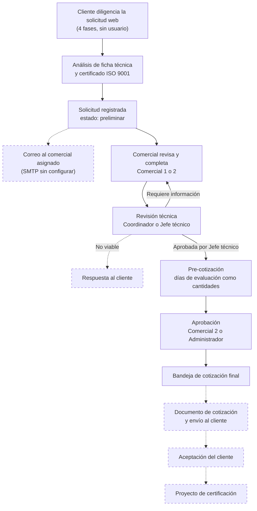
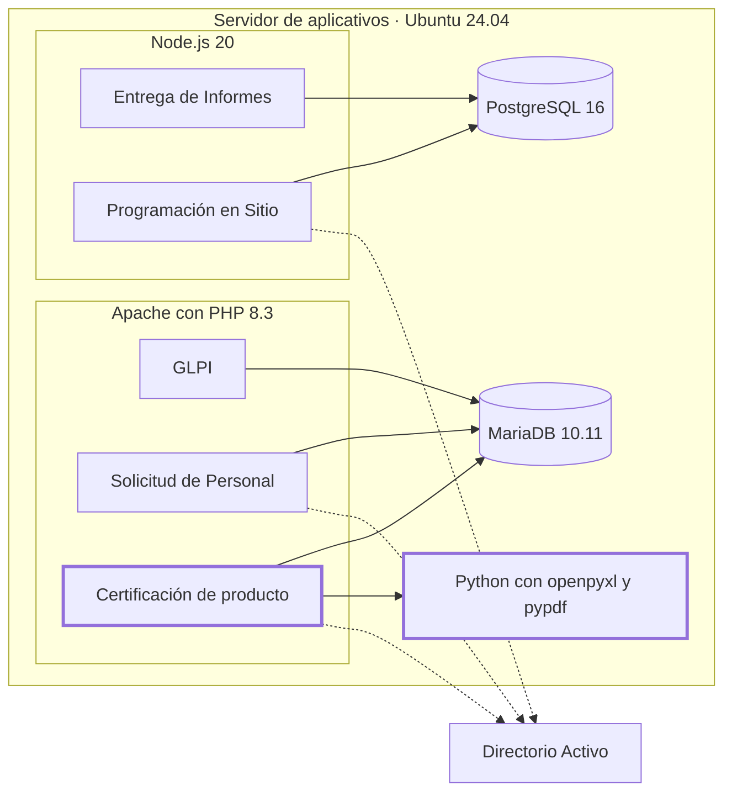

# Validación técnica del aplicativo — 16-10-2026

Revisión del software de certificación de producto (solicitudes, revisión técnica y pre-cotización), comparado con los aplicativos que Servimeters ya tiene en producción (Solicitud de Personal, Programación en Sitio y GLPI) y con el *Procedimiento para el desarrollo, revisión y puesta en operación de soluciones tecnológicas* de TIC.

- **Revisado por:** Johan Silva (TIC).
- **Base de la revisión:** este repositorio (commit `0acfd67`), una copia local con la base `software_producto.sql` del 15-10-2026, las notas de despliegue de los aplicativos en producción y el formato GMV-RG-20 V22.

## Conclusión

El aplicativo funciona de punta a punta hasta la pre-cotización aprobada. Para quedar como los que ya están en producción hay que moverlo en dos frentes:

1. **Cómo se despliega.** Está empaquetado para Docker, y el servidor donde viven los demás aplicativos no usa Docker. Además entra con usuarios propios en vez del Directorio Activo, y no tiene script de despliegue con respaldo.
2. **Terminar el proceso.** Falta la cotización final y la solicitud nunca avanza de estado.

La parte de despliegue es la más rápida: se puede tener un **piloto interno en unas 2 semanas**, como se hizo con Programación en Sitio.

| Indicador | Valor |
|---|---|
| Componentes validados | 11 |
| Ajustes para alinearlo a producción | 9 (54–77 h) |
| Cambios funcionales | 8 (78–116 h) |
| Formalización ante TIC | 28–44 h |
| **Esfuerzo total** | **160–237 h** |
| Duración con una persona dedicada | 6 a 8 semanas |

Como supera las 40 horas, el procedimiento de TIC pide tramitarlo por Innovación con el formato GTI-RG-03.

## Comparación con lo que está en producción

Solicitud de Personal, Programación en Sitio y GLPI corren en el mismo servidor Linux (Ubuntu 24.04). Ese servidor ya tiene Apache con PHP 8.3 (mod_php), Node.js 20, MariaDB 10.11 y PostgreSQL 16. **No tiene Docker.**

| Aspecto | Solicitud de Personal | Programación en Sitio | GLPI y Copiloto IA | **Este aplicativo** |
|---|---|---|---|---|
| Estado | En producción desde el 28-08-2026 | Piloto en producción desde el 07-09-2026 | GLPI 11 en producción; Copiloto en MVP | Solo local, sin desplegar |
| Tecnología | Laravel 11, PHP 8.3 | Node.js + Express, React | GLPI (PHP); Copiloto en Python (FastAPI) | PHP nativo y Python, sin framework |
| Base de datos | MariaDB 10.11, usuario propio | PostgreSQL 16, rol propio | MariaDB | MariaDB hoy; PostgreSQL previsto sin probar |
| Publicación | Apache, dominio propio, HTTPS con Let's Encrypt | Servicio systemd, solo red interna y VPN | Apache, dominio y HTTPS | Contenedor Docker (el servidor no tiene Docker) |
| Inicio de sesión | Directorio Activo (LDAP) y tabla que autoriza | Directorio Activo (LDAP) y tabla de roles | Usuarios de GLPI; Copiloto con cuenta técnica de solo lectura | Usuario y contraseña propios |
| Roles | Por etapa del flujo, validados en el servidor | 5 roles validados en el servidor | Perfiles de GLPI | 5 roles validados en cada pantalla y endpoint |
| Código | GitHub privado | GitHub privado | GitHub con integración continua | GitHub, un solo commit |
| Pruebas | Suite PHPUnit | Pruebas por rol en modo demo | pytest en cada cambio | 4 scripts PHP y 4 de navegador, atados a rutas de XAMPP |
| Seguridad | Pentest con Strix, hallazgos corregidos | Secretos solo en `.env` con permisos 600 | IA clasificada como riesgo medio, con supervisión humana | Revisión de seguridad pendiente |
| Despliegue | Script con respaldo de código y base | Script repetible con verificación de salud | — | `docker-compose`, no aplica a este servidor |
| Imagen | Identidad SM Servimeters | Identidad corporativa GMV-MN-01 | — | Colores genéricos, sin marca |

Lo que este aplicativo ya tiene a la par o mejor: el control de roles y la protección CSRF están al nivel de Programación en Sitio, y la respuesta a los requisitos de TIC está más documentada que en los demás.

## Qué tanto hay que moverlo

### Decisión previa: base de datos

- **Recomendada: Apache y MariaDB, como Solicitud de Personal.** Es el motor donde el aplicativo ya funciona y donde están los datos. No suma nada nuevo al servidor.
- **Alternativa: Apache y PostgreSQL, como Programación en Sitio.** Cumple el requisito B-03 de TIC y facilita los reportes en Power BI. El esquema `database/postgresql_schema.sql` tiene las mismas 25 tablas y el código tiene las dos variantes de SQL, pero nunca se ha ejecutado en PostgreSQL: suma **16–24 h** de pruebas y migración.

### Ajustes de alineación (54–77 h)

| Ajuste | Hoy | Cómo está en producción | Esfuerzo | Horas |
|---|---|---|---|---|
| Plataforma | Docker | Sitio en Apache con mod_php, dueño `www-data`, `.env` con permisos 600 | Medio: replicar en Apache las restricciones de `docker/apache-vhost.conf`, revisar las extensiones `zip` y `mbstring`, y montar Python con openpyxl y pypdf | 8–12 |
| Base de datos | MariaDB 10.4 local | Base y usuario propios en MariaDB 10.11 | Bajo | 3–4 |
| Inicio de sesión | Contraseñas propias | Directorio Activo autentica y una tabla autoriza | Alto: conectar con el Directorio Activo y conservar la tabla `usuarios` para los roles. El formulario de clientes sigue sin usuario | 12–16 |
| Repositorio | Un commit | Rama `main` protegida y cambios por PR | Bajo | 2–3 |
| Despliegue | `docker-compose` | Script con respaldo (tar y mysqldump), staging y reversión | Medio | 6–8 |
| Dominio y HTTPS | Sin dominio | Subdominio con Let's Encrypt | Bajo | 3–4 |
| Seguridad e IA | Sin revisión | Pentest con Strix, corrección de hallazgos e IA clasificada por riesgo | Medio: obligatorio antes de abrir el formulario público | 10–16 |
| Imagen | Sin marca | Identidad GMV-MN-01 | Bajo: el CSS ya está centralizado en `assets/css/system.css` | 6–8 |
| Documentación | README | Nota de proyecto con decisiones, errores y despliegue | Bajo | 4–6 |

## Cambios funcionales (78–116 h)

| Prioridad | Cambio | Detalle | Horas |
|---|---|---|---|
| Crítico | Cotización final | `cotizacion_final.php` solo lista las pre-cotizaciones aprobadas. Falta el documento, la numeración, el envío y la aceptación del cliente; depende de que Comercial defina el formato | 24–40 |
| Crítico | Refuerzos de seguridad | Ajustes al formulario público, a la carga de archivos y al manejo de sesiones. El detalle está en el informe interno de TIC | 10–15 |
| Alto | Estados de la solicitud | Ningún archivo cambia `solicitudes_servicio.estado`; las 6 solicitudes siguen en `preliminar`. Faltan las transiciones a `validada`, `convertida_proyecto` y `archivada` | 8–12 |
| Alto | Formulario frente al GMV-RG-20 V22 | De las fábricas solo se guarda nombre, país y dirección; faltan zona de muestreo, alcance ISO, número de certificado, certificador y acreditador (las columnas ya existen en `solicitud_fabricas`). Faltan la sección 2.3 (modificaciones y seguimientos) y los soportes de auditoría de planta y de certificaciones de otros organismos | 12–16 |
| Alto | Matrices en la base de datos | Las matrices base salen de datos incrustados en `preview (27).php`, `preview (28).php` y `constructor_iso_juguetes.php` (unas 5.600 líneas). La tabla `matrices` está vacía | 12–16 |
| Medio | Archivar en vez de borrar | `api/delete-service-request.php` borra la solicitud con sus productos, fábricas y adjuntos | 4–6 |
| Medio | Correo | Usar la cuenta SMTP de Office 365 de Solicitud de Personal; hay 8 notificaciones en `pendiente_configuracion` | 2–3 |
| Medio | Depurar datos con Calidad | Las 6 pre-cotizaciones no tienen revisión técnica aprobada porque se crearon antes de esa regla. Conviven dos catálogos RETIE: 106 registros `RETIE` y 212 `RETIE_40117` | 6–8 |

**Formalización ante TIC (28–44 h):** pruebas con el responsable funcional, correcciones y acta GTI-RG-05 (20–32 h), y manual de usuario con modelo de datos (8–12 h).

## Plan propuesto

Con una persona dedicada y unas 6 horas efectivas al día: entre 27 y 40 días hábiles. Si se mantiene PostgreSQL, se suman 3 a 4 días.

| Semanas | Fase | Horas | Contenido |
|---|---|---|---|
| 1–2 | Piloto interno | 43–62 | Apache y MariaDB, Directorio Activo, repositorio, script de despliegue y refuerzos de seguridad. Solo red interna y VPN |
| 3–5 | Proceso completo | 44–61 | Estados de la solicitud, campos del GMV-RG-20 V22, matrices en la base de datos, archivado, correo y depuración de datos |
| 5–6 | Cotización final | 24–40 | Documento, numeración, envío y aceptación del cliente |
| 7–8 | Apertura y entrega | 49–74 | Dominio con HTTPS, pentest, imagen corporativa, documentación, pruebas con usuarios y acta GTI-RG-05 |

## Flujo del aplicativo

Las líneas punteadas son pasos que todavía no están construidos o que dependen de una configuración pendiente.

Módulos de apoyo: matrices normativas, laboratorios y ensayos, criterios de pre-cotización, y usuarios y roles (Administrador, Comercial 1, Comercial 2, Coordinador técnico y Jefe técnico).

## Dónde quedaría

Con la opción recomendada, el aplicativo usa el mismo Apache y la misma MariaDB que Solicitud de Personal y GLPI. Lo único nuevo en el servidor son las librerías de Python del análisis documental.

## Lo que funciona

| Componente | Validado |
|---|---|
| Acceso y roles | Contraseñas cifradas, bloqueo de 15 minutos tras 5 intentos fallidos, cambio obligatorio de contraseña temporal y CSRF en todos los formularios internos. Los permisos de los 5 roles se validan en páginas y endpoints (22 de 23 endpoints revisados). Comercial 1 solo ve sus solicitudes |
| Solicitud del cliente | 4 fases, reglas de esquema y propósito (1A y 1B solo otorgamiento; 4 y 5 con seguimientos y renovación), recomendación según ISO 9001, checklist de documentos, lote y cantidad obligatorios en 1B. 441 productos en 15 referentes |
| Análisis documental | Extrae datos de la ficha técnica y del certificado ISO, con alertas por vencimiento o alcance. *No se ejecutó en esta revisión* |
| Revisión técnica | Checklist, alcance, ISO, Test Reports, tipo de auditoría, viabilidad y días por actividad con factor de seguridad |
| Pre-cotización | Exige revisión técnica aprobada; los días pasan como cantidades; la aprobada queda bloqueada |
| Laboratorios | Alta, edición e importación de ensayos (1 laboratorio, 328 ensayos) |
| Matrices | Plantilla oficial y matrices base: Juguetes 249, Vajillas 34, RETIE 106 y RETILAP 39 registros |
| Trazabilidad | Bitácora con 132 eventos |
| Base de datos | Mismas 25 tablas en MySQL y PostgreSQL; variantes de SQL para ambos motores |
| Archivos | Los 16 adjuntos referenciados existen en disco |
| Código | Sin errores de sintaxis PHP; `tools/test_embedded_matrices.php`, `test_matrix_xlsx_generation.php`, `test_service_request_extract.php` y `validate_matrix_template.php` aprobadas |

## Notas para levantarlo en local

- El PHP de XAMPP trae la extensión `zip` desactivada, y sin ella fallan la lectura y generación de Excel. Se puede activar solo para el servidor de pruebas: `php -d extension=zip -S 127.0.0.1:8000`.
- El servidor embebido de PHP no aplica las reglas de `.htaccess`. Úsalo solo en `127.0.0.1`.
- `SERVIMETERS_PYTHON_PATH` debe apuntar al Python del equipo donde corre (en `.env.local`, no en el repositorio).

## Comparación del repositorio con la copia de trabajo

El código del commit `0acfd67` es idéntico a la copia local revisada; solo cambian los saltos de línea, que normaliza `.gitattributes`. La copia local tiene además archivos que no deben versionarse y que el `.gitignore` del repositorio ya excluye: `.env.local`, PDF de listas de chequeo, adjuntos en `storage/uploads`, sesiones y temporales.

## No cubierto

No se entró al servidor de producción: las versiones y extensiones salen del inventario documentado. No se ejecutaron el análisis con Python o Gemini, las pruebas de navegador (`tools/*_smoke_check.js`) ni el flujo en PostgreSQL.
